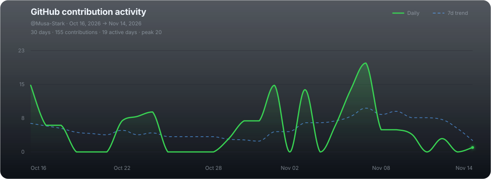

<!-- Profile README for Musa-Stark -->

<h1 align="center">Hey, I'm Muhammad Musa 👋</h1>
<h3 align="center">Musa Stark · JavaScript Full Stack Developer · Backend Engineer in Progress</h3>

  

  
  
  

  

## 👨‍💻 About Me

I'm a developer who enjoys understanding how software works beyond the surface — from APIs and databases to Linux systems and the infrastructure that runs applications.

- 💻 My core stack is **JavaScript, Node.js, Express, React, and Next.js**.
- 🧠 Currently strengthening **backend engineering, Data Structures & Algorithms, and computer science fundamentals**.
- 🐧 Exploring **Linux, networking, virtualization, self-hosting, and DevOps** through hands-on labs.
- 🏗️ Building **StarkLabs**, my long-term ecosystem of software and infrastructure products.
- 🚀 Investing in **Go (Golang)** for backend engineering and systems development.
- 🎓 Computer Science student, learning through coursework and building real projects.

  
<b>🧭 My current learning focus</b>

   
  <ul>
    <li>Data Structures & Algorithms — building strong problem-solving fundamentals</li>
    <li>Backend engineering — APIs, authentication, databases, and system design</li>
    <li>Linux & networking — understanding the foundations behind deployments</li>
    <li>Infrastructure — running and managing virtual machines with Proxmox</li>
    <li>Go — building proficiency in a compiled language for backend and systems development</li>
  </ul>

> I learn by building, debugging, and understanding the systems behind the tools I use.

---

## 🏢 What I'm Building — StarkLabs

An independent technology ecosystem focused on software engineering, developer tools, and cloud infrastructure.

| Project | Description |
| --- | --- |
| **Stark Cloud** | An EC2-inspired cloud platform built on Proxmox virtualization. |
| **Stark Forge** | A Node.js backend framework focused on reducing repetitive boilerplate. |
| **Stark OAuth** | Centralized authentication — “Continue with StarkLabs”. |
| **Stark Vault** | A planned secrets management system for application credentials. |

  

---

## 🛠️ Tech Stack

  

  
  
  
  

**Currently working with:** JavaScript · TypeScript · Node.js · Express.js · React · Next.js · MongoDB · Git

**Learning:** Go · Linux administration · Networking · Proxmox · Infrastructure · DevOps

---

## 📊 GitHub Overview

  
  

  

### 📈 Contribution Activity

  

---

## 🐍 The Contribution Snake

  

---

## 🎮 Beyond the Code

- 🧪 Homelab tinkering: virtual machines, networking, and self-hosted services.
- 🧩 Problem-solving: gradually sharpening my DSA skills with practice.
- 🤝 Student tech activities: quizzes, mock interviews, and helping build a tech community.
- ☕ Fuel: curiosity, stubborn debugging, and the occasional coffee.

### 💬 Developer Joke

  

### 🧠 Dev Quote

  

---

## 🤝 Let's Connect

  
  
  

  <i>“The best way to predict the future is to build it.”</i>

  

  

